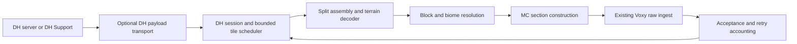

# DH server compatibility for the LSS client

Date: 2026-09-29. Status: local implementation in progress; the NeoForge refresh/settings
checkpoint passed on 2026-10-01. The original proposal was revised after a four-agent
review (three Opus lenses plus one Fable adversarial lens; record and dispositions in
§12). A [local single-tile POC](2026-09-29-dh-client-poc.md) now proves protocol-15
DH Support terrain reaching Voxy on Fabric 1.21.1 without a DH client or LSS server.
Solid terrain renders in the software control; the WSL D3D12/NVIDIA path omits
opaque faces despite verified Voxy block storage and remains unresolved.
Experimental Fabric and NeoForge sessions and a shared scheduler are implemented; the full S0–S2
validation and release gates remain outstanding.

**Accepted limitation (2026-10-07):** the user accepts the known Voxy queued-write
ordering and completion/persistence boundary for now. An already queued DH write
can commit after newer vanilla terrain; the supported API cannot cancel/fence it
or supply a per-write completion/persistence receipt. This is **no longer a release
blocker**. The absolute I1 guarantee, corresponding spike kill criterion and strict
completion gate are waived at this boundary only; retain the implemented guards
and all other qualification requirements. This decision supersedes earlier blocker
wording below and in historical reviews/receipts without declaring the race fixed.
[Decision, evidence and revisit conditions](../implementation/2026-10-07-dh-accepted-limitations.md).

**Current checkpoint (2026-10-09):** the October 8 verified review fixes pass
normal and ten-case packaged validation; the former permission restriction is
resolved. The user's menu simplification now removes the separate DH page,
moves **Use Distant Horizons** into General, and keeps sync/live preferences
file-only with true defaults. Normal verification passes 3,421 production tests,
86 server gametests and all six artifact gates; four fresh UI/config-reload cases
pass. The tested client is installed and the same-world manual server/OP resumed.
[Menu change and exact validation](../implementation/2026-10-09-dh-menu-simplification.md).
[New complete-feature Claude brief](../implementation/2026-10-09-dh-full-feature-claude-review-briefing.md).
This dated decision supersedes earlier three-checkbox DH menu requirements.
The accepted Voxy boundary, unproven movement-pause cause, remaining original
qualification/outreach and release prerequisites retain their existing status.

**Full-feature review follow-up (2026-10-07):** verified reconnect, detection,
pressure, cache, face-light, legacy-menu, status, packaging and evidence findings
are corrected locally. [Disposition and current validation boundary](../implementation/2026-10-07-dh-full-feature-review-disposition.md).
This source checkpoint does not replace the historical r5 playable artifact:
the normal build/live gates remain blocked by the current sandbox environment,
the manual server is stopped with its world saved, and Prism still has r5.
At that checkpoint the Voxy commit-ordering limitation was a blocker; the dated
acceptance above supersedes that classification. Larger performance/live coverage
remains open. No new performance run is scheduled; the host is available for games.

**Normal validation recovered (2026-10-07):** unrestricted access permits the normal
Java21 build:3365 unit/observer tests,78 Fabric and8 NeoForge gametests, and all six
LSS/VSS packaging checks pass. Fourteen fresh functional cells cover both loaders,
both DH families/official versions, native precedence, lifecycle, narrow legacy
menus,6,590,848 content comparisons and a genuine range128 physical rejoin after
cache pressure. [Exact validation and manual restoration](../implementation/2026-10-07-dh-full-feature-validation.md).
The tested r6 NeoForge jar is installed and the same world/OP is restored at
[::1]:25585. Performance is not rerun. The known Voxy I1 ordering/completion
limitation is accepted for now; remaining qualification/outreach is still open.

**Trace follow-up (2026-10-07):** the user's empty trace exposed missing DH hooks
in the native-only event logger. DH requests/replies, periodic status and distinct
pressure causes now emit locally; every trace flushes a start record. The normal
build passes3367 unit tests,86 server gametests and all six artifact checks. Both
packaged loader clients produce44 status rows and47 matched request/reply pairs
with terrain readback. The shorter “Use DH” tooltip and removal of the redundant
`/lss dhstatus` alias are included. The r7 jar is installed and the same manual
server world is resumed. [Fix, exact validation and setup](../implementation/2026-10-07-dh-trace.md).
This fixes tracing, not the unconfirmed cause of the movement-related pause.

**Official-client behavior follow-up (2026-10-08):** the r9 candidate adds Slow
Start, shared rate/concurrency admission, service-specific refusal backoff and
obsolete-generation cancellation. Normal and packaged checks pass; the selected
Prism client and same-world manual server are restored.
[Current implementation and validation](../implementation/2026-10-07-dh-parity-disposition.md).
The [next improvement plan](2026-10-08-dh-official-behavior-improvements-plan.md)
prioritizes acquisition-wait diagnostics, an evidence-gated timeout-cleanup fix
and a measured fragment-copy reduction. It does not establish the cause of the
user's movement pause or schedule new server-load or Windows GPU benchmarks.

**Official follow-ups completed (2026-10-08):** acquisition-wait diagnostics,
safe-cutoff expiry under unrelated traffic and a measured internal fragment-copy
reduction are implemented. The final candidate passes 3,408 production
tests, 86 server gametests, all six artifact gates and ten packaged functional cases.
The tested client is installed and the same-world manual server/OP is restored.
[Implementation, evidence and manual course](../implementation/2026-10-08-dh-official-behavior-followups.md).
[Claude brief for every change since the r5 review](../implementation/2026-10-08-dh-post-review-claude-briefing.md).
Offline allocation measurements support the copy change; new server-load/Windows
GPU benchmarks are not run. The ordinary-play pause's cause is still unconfirmed.

**POC authorization (2026-09-29):** after 0.16.0 was published, the user requested
a simple proof and confirmed "Keep this local; outreach is pending." This is a
local-only exception to the outreach prerequisite below, not upstream consent.
Work is isolated on `spike/dh-client-poc-mc1.21.1` from `v0.16.0+mc1.21.1`.

**P1 implementation (2026-09-30):** the user selected P1 as this task’s stopping
point. The production common codec core is implemented in the isolated
feat/dh-codec-p1-mc1.21.1 checkout. [Implementation and validation record](../implementation/2026-09-30-dh-codec-p1.md).
38 Java cases, private upstream format-2 encoder parity and relocated-XZ smoke
checks pass. Official wire fixtures and normal Gradle/platform artifact gates
remain pending. Work remains local and outreach pending.

**First playable follow-up (2026-10-01):** after the user's NeoForge request,
both loader transports are implemented. Java 21 normal Gradle suites and server
gametests passed in an isolated source copy. A private NeoForge 21.1.248 client
with Voxy, against official DH 3.3.3 on MC1.21.1, passed actual storage comparisons,
movement and reset. Official frames are now frozen; verified Claude review defects
were corrected. [Current setup and evidence](../implementation/2026-10-01-dh-first-playable.md).
The official reference differs from 3.3.4 because that version has no MC1.21.1 build.
The old sandbox restriction no longer applies. Native Windows rendering, UI
selectors, S0–S2/load gates and complete P2/P3/P4/release gates remain open. This is
an experimental local checkpoint, not a released compatibility claim.

**Refresh/settings continuation (2026-10-01):** the user reported the Windows
NeoForge client working and requested continued implementation. Shared Sodium
source/profile/refresh controls, hot refresh reconciliation, conditional server
stamp requests and DH-specific status/export are implemented. The final NeoForge
artifact passes full unit/server regression gates and private actual-Sodium,
refresh, reception, Nether/End, portal-return and source-switch checks.
[Checkpoint, exact evidence and remaining gates](../implementation/2026-10-01-dh-refresh-settings.md).
This advances P3 locally; the full live matrix, load comparison, strict P2 ingest
completion acknowledgement and release gates remain open. Outreach is still pending.

**P3 review follow-up (2026-10-01):** the verified findings in the independent
Claude review are addressed, including parked unreachable absence, refresh fairness,
transient client-thread hitches, reset/status handling and UI/evidence corrections.
[Corrections and current verification](../implementation/2026-10-01-dh-p3-review-disposition.md).
The earlier P3 artifact/evidence remain historical; this follow-up requires its own
artifact binding and private live checks. Release gates and outreach remain open.

**P4 content continuation (2026-10-01):** the first private custom-height run missed
its target conditional-request deadline. Both acquisition-frontier preemption and
fixed-order starvation fit the evidence; the separate scanner regression
reproduces the latter. Identical native/DH storage colours did not independently
prove DH content. [Historical record](../implementation/2026-10-01-dh-p4-content-validation.md).

**P4 review follow-up (2026-10-05):** the retained connection policy now preserves
refresh age across session replacement and hot interval changes. New pins cover
restart, tie order, filters, pending work and the ten-second ceiling. The private
content fixture uses distinct source-specific colours, present-section sentinels,
settled acquisition, owned response/conversion correlation and request telemetry.
Both private NeoForge / official DH 3.3.3 content and lifecycle runs passed. The
captured unchanged/removal corpus now has a passing permanent Common regression;
the verified candidate is installed in the selected Prism instance and the same
manual server world is running again.
[Corrections and current verification](../implementation/2026-10-05-dh-p4-review-disposition.md).
The complete P4 matrix and release gates remain open.


**P2/P4 continuation (2026-10-05):** eleven additional real-session pipeline cases
pass, and a real official DH 3.2.0-b/protocol-15 ceiling-air compatibility defect is
fixed with a frozen producer capture and pre-fix red regressions. The final normal
build passes 3251 unit tests, 86 server gametests and all six LSS/VSS packaging
checks. All eleven functional packaged live scenarios pass, including Fabric
Support/official-16, NeoForge Support Full/Fast, official-15/16, no-service,
profile mismatch, real-DH conflict, lifecycle and content/removal/native reconnect.
A separate controlled queue experiment proves an older DH write can overwrite
newer vanilla storage in the installed Voxy port. The strict per-write completion
acknowledgement and absolute vanilla-authority gates remain open at that boundary. No milestone is
claimed complete on queue acceptance or backlog zero alone.
[Continuation and exact evidence](../implementation/2026-10-05-dh-p2-p4-continuation.md).
[Ready manual course](../implementation/2026-10-05-dh-manual-test-guide.md).

**Ocean lighting follow-up (2026-10-05):** verified DH surface-light sampling
caused bright Voxy ocean floors. The shared converter now attenuates water
skylight with depth. A frozen real producer tile and synthetic tests cover
shallow/deep water, section boundaries, block light and no-sky dimensions.
The normal build passes 3254 unit tests and 86 server gametests; private Fabric
and NeoForge clients each pass 900 actual stored water-light samples. The tested
jar is installed, and the same manual server now allows distant generation
within 32 chunks at the user's request. The user's Windows retest confirms the
lighting is fixed and reports good overall appearance. Strict P2/P4 gates remain open.
[Correction and exact evidence](../implementation/2026-10-05-dh-ocean-lighting.md).

**Rejoin cache follow-up (2026-10-05):** at the user's request, reconnects now
retain complete validated DH source DTOs and replay them through the current
converter and vanilla authority guards. Like official DH, cached terrain receives
a sync-on-load timestamp check; only missing or changed terrain needs a full
payload. This works with continuous refresh Off, survives a Minecraft restart
and Voxy cache loss, and is cleared by explicit reset/clear commands. The normal
build passes 3271 unit tests, 86 server gametests and all six packaging checks.
Private Fabric and NeoForge clients each pass 2100 independent block comparisons,
including offline edits and unchanged replies with zero target terrain payloads.
The tested NeoForge candidate is installed in the selected Prism instance.
This retains source data independently of Voxy, not persistent Voxy acceptance
claims; the strict P2/P4 commit and vanilla-authority gates remain open.
[Implementation and evidence](../implementation/2026-10-05-dh-rejoin-cache.md).

**Voxy cache reuse follow-up (2026-10-05):** reconnect now compares retained DH
source data with Voxy's existing level-zero blocks, biomes and lighting before
delivery. Matching columns get session-local receipts with zero conversion or
ingest; missing/different columns rebuild individually. Both packaged Fabric
and NeoForge clients pass 2400 independent block comparisons each, including
zero target reimports on unchanged rejoin and a full JVM restart, exactly one
repaired column after deliberate damage, offline edits, complete Voxy cache loss,
explicit reset and source loss. The normal build passes 3279 unit tests, 86 server
gametests and all six packaging checks. This supersedes unconditional replay in
the preceding checkpoint and keeps the strict P2/P4 gates open.
[Implementation, limits and evidence](../implementation/2026-10-05-dh-voxy-cache-reuse.md).

**Post-P4 review corrections (2026-10-05):** source-cache timestamp validation now
precedes destination restoration. Unchanged cached mismatches preserve existing
terrain; only entirely default columns rebuild. Quota/LRU, superseded-file
invalidation, cache retries/reset ownership and fluid-plant lighting are corrected.
The lifted sandbox enabled the final normal gauntlet: 3308 tests, 86 server
gametests, all six packaging checks and five fresh packaged live cells pass.
A native Windows junction bypass was verified and fixed; final atomic/long-path
cache IO and junction refusal pass. The corrected NeoForge jar is installed and
the same manual server world is running, with preferences and OP retained.
[Disposition, regression evidence and pending deployment](../implementation/2026-10-05-dh-post-p4-review-disposition.md).
This checkpoint supersedes the reconnect behavior and setup status above.

**Official-behavior follow-up (2026-10-06):** at the user's request, the custom
periodic timer is removed in favor of optional sync on load and negotiated server
live updates. This explicitly extends the original deferral of applying partial
updates. [Implementation and verification](../implementation/2026-10-06-dh-sync-live-updates.md).

**Vanilla-border follow-up (2026-10-06):** the shared Voxy bridge now fills the
loaded vanilla fringe from current vanilla chunks. Packaged native LSS and
official-DH private clients each pass 71-column cold coverage with zero missing
columns. This does not relax DH authority or close the outstanding completion
gates. [Fix and exact-artifact proof](../implementation/2026-10-06-vanilla-lod-border-gap.md).

**P4 coverage/performance continuation (2026-10-07):** full raw-source block/biome/light
comparisons at Voxy levels0–4, sky/no-sky/custom height, official15/16 and both
Support builders pass. A bounded effective-range128, multi-dimension global-cache
pressure/return run passes. Native legacy Sodium menu controls/layout and NTFS
file/byte quotas, costs and sharing-lock recovery pass. Twelve actual native
Windows official-DH versus LSS+Voxy runs compare identical complete terrain;
LSS acquisition is about twice as slow in this small-area experiment, with nearly
identical capped steady-camera frame intervals. Real exclusive-ceiling AIR and
SURFACE-only upper AIR defects are fixed with captured/pre-fix regressions; all
normal builds,3345 unit/observer tests,86 server tests and packaging gates pass.
[Exact artifacts, measured results, scope and remaining gates](../implementation/2026-10-07-dh-p4-coverage-performance.md).
Strict I1/persistence/ordering, complete stress/biome/material matrices, uncapped
loading frame studies, outreach and release gates remain open.

## 1. Recommendation and scope

The proposed feature is feasible based on the upstream implementations: an LSS
client can speak the Distant Horizons (DH) network protocol, request block-resolution
terrain, convert the returned block/biome/lighting spans into Minecraft sections,
and submit those sections through LSS's existing Voxy raw-ingest bridge.

The server would run DH or DH Support, and the client would run LSS plus a compatible
Voxy build. Neither the DH client mod nor LSS on the server is required by the
protocol paths inspected. Loader interoperability still needs a packaged live
proof before claiming this works in a released build.

Implement this as an **explicit, experimental client terrain source**, but only
after a time-boxed spike (§9, S0-S2) retires the riskiest unknowns and passes the
kill criteria in §9. The first release is **1.21.1 only, Fabric and NeoForge**
(the one line with a proven Voxy pairing on both loaders), starting with the one
protocol profile the spike proves cheapest; the second profile follows on the same
line. Porting to the other four lines is a separate, demand-driven decision (§9 P5),
not part of the completion criteria. Keep the completed 0.16.0 release candidates
separate: nothing here starts until 0.16.0 is published, and this work then branches
from the published 1.21.1 support head.

Prerequisites before any code (review fold, §12):

- **Ask the DH team first.** Neither DH project states a policy on third-party
  clients. Before S0, ask on the DH GitLab/Discord whether a non-DH client is
  welcome and which request pattern they would accept. A clear "no" is a kill
  criterion; silence is recorded, not treated as consent.
- **Document the cooperative path now.** LSS already coexists with DH Support on
  one server (issue #82). Add a README/FAQ note: "Voxy player on a DH server? Ask
  the admin to add LSS alongside DH." This costs nothing and serves the
  admin-cooperative half of the audience whatever happens to this plan.
- **Record demand.** The plan has no measured population. Note the independent
  user requests for "Voxy on a DH server without admin cooperation" (none are
  known at the time of writing) and revisit scope if they stay at zero.

The feature implements an alternate protocol; it need not falsify the installed
mod list, change Minecraft authentication, or bypass server limits. Server distance,
generation, bandwidth, world-border, and refusal decisions remain authoritative.

Initial scope:

- Fabric and NeoForge clients on Minecraft 1.21.1 only. Other lines are deferred
  (§9 P5) and ported one batch at a time on demand.
- One DH protocol profile first (the spike picks it; likely protocol 15 against
  DH Support 0.14.0, whose request surface is smallest), then the second:
  - protocol 15: DH Support 0.14.0 and the official DH 3.2.0b reference;
  - protocol 16: the official DH 3.3.4 reference, with 3.3.0 compatibility fixtures.
- A support window of the **latest two DH protocol profiles**, with an upstream
  protocol watcher (§9 maintenance) so a DH bump is noticed before users report it.
- Block-resolution snapshot acquisition, reconnect freshness, bounded ongoing
  refresh, and Voxy ingestion.
- Existing YAML/reload behavior, ordinary Sodium options, and English/Chinese text.

Deferred extensions: the other four MC lines, a persistent receipt index (§5.3),
LZ4 and Zstd-stream decoding, DH protocol 11/13, automatic choice between LSS and DH,
simultaneously running a real DH client, applying DH partial updates directly,
feeding Xaero or arbitrary LSS API consumers, and inventing detail from coarse DH
data. These are not prerequisites for the proposed first release.

## 2. What the source establishes

### 2.1 Two different detail-level numbers

DH database/data detail level **0** means one terrain column per horizontal block.
The corresponding **network section detail level is 6**, because a section holds
64 by 64 columns. One such request covers 64 by 64 blocks, or 4 by 4 Minecraft
chunks. Sending a network section with detail byte zero would be incorrect.

For chunk coordinates `(cx, cz)`:

```text
DH section X = floorDiv(cx, 4)
DH section Z = floorDiv(cz, 4)
network section detail = 6
covered chunk X = sectionX * 4 .. sectionX * 4 + 3
covered chunk Z = sectionZ * 4 .. sectionZ * 4 + 3
```

DH packs the detail and two signed coordinates into a long. Use independently
tested encode/decode routines, including negative coordinates and representable
range checks; do not reuse LSS's chunk-position packing.

Sources: [DH section coordinates][dh-pos], [database detail conversion][dh-repo].

### 2.2 When ordinary DH clients receive detail 0

| Implementation | Observed behavior |
| --- | --- |
| Official DH 2.4.5b | `enableNSizedGeneration` defaults to false. The client splits coarse acquisition requests, and the server independently refuses non-leaf acquisition requests when its setting is false. Ordinary acquisition therefore downloads block-resolution tiles across the requested area, including distant terrain. Coarse acquisition requires enabling the experimental option on both sides. |
| Official DH 3.3.4 | Initial requests follow the client's LOD tree, so distant requests can be coarse. Nearby high-detail requests can be detail 0. A server with surface generation disabled rejects coarse acquisition and requires splitting to block detail. |
| Official DH 3.3.4, surface-then-chunks | After coarse retrieval, the regeneration path explicitly schedules block-resolution retrieval for marked areas. It waits for coarse work, requires a chunk-capable effective plan, and obeys regeneration-distance and network limits. The default regeneration distance percentage is -1, meaning no extra percentage-based cutoff; this does not remove server limits. |
| DH Support 0.14.0 | The request handler accepts **only network section detail 6**. Its terrain service is already a block-resolution request source. |

The important result for LSS is that **the client can explicitly request section
detail 6**. We do not need to imitate DH's visual LOD-distance selection, move the
player closer, or run its quadtree. The server may still reject or defer a request.

Sources: [2.4.5 client splitting][old-remote], [2.4.5 server gate][old-server],
[3.3 server gate][dh-server], [3.3 refinement][dh-propagator],
[regeneration limits][dh-worldgen-util], [DH Support request handler][plugin-lod].

### 2.3 Block resolution is not a full Minecraft chunk

DH transmits terrain spans with block/biome identities, heights and lighting.
This is sufficient to construct a Voxy terrain approximation. It does not recover
entities, block-entity contents, or all original block distinctions. DH's default
world compression discards hidden block distinctions; its surface generator can
omit trees and structures. Server-plugin builders can make additional approximations.

In 3.3, detail-0 generation uses the chunk generator when the server's generator
plan allows it; a surface-only server can still return a block-spaced approximation.
Even a requested `CHUNKS_ONLY` client plan is not a guarantee: the negotiated plan
and server generator configuration govern the result, and already-cached data may
have a different history. DH Support labels its generated columns `LIGHT`, so the
generation-step metadata alone cannot certify original-world fidelity.

The UI/docs should describe this as **DH terrain rendered by Voxy**. Do not promise
the same fidelity as native LSS. Record observed surface/downsampled/unknown data
in diagnostics and never claim that level 0 restores detail previously discarded.

Sources: [DH generator selection][dh-generator], [DH configuration][dh-config],
[plugin data encoding][plugin-data].

### 2.4 Exact versions matter

The following were read from tagged source, not inferred from project names:

| Reference | DH network protocol | Channel | Terrain format written | Proposed support |
| --- | ---: | --- | --- | --- |
| DH 2.3.4b | 11 | `distant_horizons:message` | Older DTO family | Deferred |
| DH 2.4.5b | 13 | `distant_horizons:message` | Format 2 | Deferred |
| DH 3.2.0b | 15 | `distant_horizons:msg` | Format 2 | Initial target |
| DH Support 0.14.0 | 15 | `distant_horizons:msg` | Format 1, XZ/LZMA2 | Initial target |
| DH 3.3.0 and 3.3.4 | 16 | `distant_horizons:msg` | Format 2 | Initial target |

Protocol version and terrain format are separate axes. For example, protocol 15
needs both format 1 and format 2 decoders. Protocol 16 changes the session's first
config value from a boolean to a generator-plan enum and adds a regeneration flag
to the DTO envelope. Reusing the protocol-15 parser would misalign later fields.

Voxy's currently installed importer accepts terrain format 1 only. The new feature
must not delegate to that importer or depend on it acquiring an ambient SQLite
driver. It must decode network terrain directly. No SQLite work is needed.

References and hashes are recorded in the companion
[source ledger](2026-09-29-dh-client-compatibility-sources.json).

## 3. Proposed client architecture



Use the release-prepared implementations in `lss-settings-plan` (26.2) and
`lss-yaml-lines/*` as the source baseline, rather than this older checkout's
pre-YAML client code. The relevant current seams are:

| Existing seam | Intended use/change |
| --- | --- |
| `ClientNetGlue`, `ClientSessionGate` | Add an explicit terrain-source owner at join/disconnect/tick. Native LSS's discovery ladder remains native-only. The native terrain gate becomes `receive && source == lss` in both `ClientSessionGate.onJoin` and `ClientNetGlue.triggerHostHandshake` (LAN); today both send the native handshake whenever `receive && hasConsumers` (invariant I3 below). |
| Fabric/NeoForge `LSSClientNetworking` and payload registration | Register optional DH transport through loader-specific adapters. |
| `ClientColumnProcessor` | Preserve its native wire path. Share narrowly scoped delivery utilities where useful; do not fabricate LSS packets or timestamps for DH. |
| `VoxyCompat` | Expose the body of the anonymous consumer's `ingestColumn` as a package-level operation; native consumer registration still delegates to it. Detect Voxy by "VoxyCompat initialized", not `LSSApi.hasVoxelConsumers()` (the Xaero session also registers a consumer). Read Voxy's own backlog probe (`probeIngestBacklog`) directly; `maxReportedIngestBacklog` maxes across consumers and includes Xaero. |
| `LSSApi.IngestFailureHandle`, `ColumnDelivery` | No DH twin of `ColumnDelivery`. `VoxyCompat` reports failures through `LSSApi::reportIngestFailure`, which falls back to the native manager when no thread-local handle is bound. DH delivery must therefore run inside `LSSApi.withIngestFailureHandle(...)` with a DH-owned handle (`report`/`isActive`/`deferAcceptance` are already public). |
| `ResetCoordinator` | Add a DH drain/await and receipt flush to its `Deps`, and a DH-source case in the no-manager branch: its prompt ("repopulates only from vanilla") is false in DH mode (invariant I4). |
| `ColumnCacheStore` | Clear this server's native buckets (`clearForServers`, with the alias and world-sibling set from `ClientNetGlue`'s key resolution) when a DH session ingests into its world (invariant I2). |
| `SectionConstruction` and palette/block resolver seams | Construct detached MC sections without invoking version-sensitive deserialization constructors. |
| `SettingsSchemaSpecs`, generated settings records, `LSSClientConfig` | Add source/profile settings through the existing schema generator and reload lifecycle. |
| Existing client diagnostics | Report DH source, protocol, coverage, limits and failures without making `/lss` report a native LSS handshake. |

Suggested new components, with final filenames settled during implementation:

- `common/.../dh/`: transport-neutral framing, protocol profiles, coordinate
  packing, bounded terrain decoding, normalized span/identity records, error types.
- `xplat/.../networking/client/dh/`: session, scheduler, decoder queue, registry
  resolver, section conversion, delivery accounting and freshness index.
- Small Fabric/NeoForge DH payload adapters and a terrain-source lifecycle router.

Keep all MC classes out of common. Do not couple the pure codec to DH's classes or
Voxy's internal storage engine. Do not undertake a wholesale rewrite of the native
LSS request manager as a prerequisite.

DH has no `ColumnStateMap`, scanner or cadence machinery. The native
`SpiralScanner`/`RegionScanner` are not reused and DH tiles must never be pushed
through them; native state stays untouched as long as DH stays out of it.

**Shared-state invariants (review fold M1-M3, m2).** DH and native LSS share the
Voxy world, the native client cache, the handshake gate and reset. Each of these
gets an explicit invariant with a Tier 1 test before P2 starts:

- **I1, vanilla-held columns are never overwritten.** Voxy ingests vanilla chunks
  itself on load and on unload, and `rawIngest` has no quality or ordering notion:
  each section replaces what was there. Keep a per-session set of columns vanilla
  has held (recorded on the main thread from the client chunk cache) and never
  deliver DH data into it (§5.4).
  The 2026-10-07 decision accepts the residual already-queued-write race; this is
  an admission/delivery guard, not an absolute Voxy commit-ordering guarantee.
- **I2, switching back to native LSS replaces DH approximations.** Without action,
  native stamps in `ColumnCacheStore` make the server answer `up_to_date` and the
  DH approximations become permanent. A DH session that ingests into a server/world
  invalidates that server's native buckets (§5.4).
- **I3, one terrain source per connection.** The native handshake and terrain
  requests are gated on `source == lss`. On a server running both LSS and DH, DH
  mode does not run the native pipeline into the same Voxy world (§4.3).
- **I4, reset owns DH work.** `/lss reset` drains the DH conversion worker before
  Voxy teardown and flushes DH receipts, exactly as it drains the native decode
  executor today (§6.1).

For the first release, deliver DH columns **only to the Voxy sink**. Calling the
existing `LSSApi.dispatchColumn` directly would also feed Xaero and third-party
consumers and imply a native-LSS data contract that this feature has not validated.
Native LSS delivery remains unchanged. General consumer support can follow with
an explicit source/quality contract.

## 4. Connection, protocol and ownership

### 4.1 Explicit source and profile selection

Add two supported source values: `lss` (default) and `distant_horizons`. A physical
connection owns one terrain source. Source/profile changes become effective on
reconnect, through the existing settings machinery.

Do not probe a live DH connection repeatedly using incompatible versions. The
official server's mismatch handler sends a close message and closes its DH network
session; retrying another version on that same connection is not a safe negotiation
strategy. Use the selected profile for the initial request. A response header can
report the server's actual protocol and produce an actionable reconnect message.
Passive version detection can be added later only if proved on both server families.

The two families differ here. The official server closes its DH session on a
mismatch. DH Support closes nothing: it only sends a close reason. "Retrying is
unsafe" therefore holds for the official mod only, but the one-profile-per-connection
rule stays for both so the behavior is uniform. **Never send a CloseReason message
to DH Support**: the plugin throws a `RuntimeException` on receiving one
(`PluginMessageHandler.java:98-100`). Teardown toward DH Support is silent.

A profile-15 client and profile-16 client use the same channel but different codecs.
Unsupported profiles fail locally; unknown server versions stop DH acquisition
without disconnecting ordinary Minecraft or guessing the payload layout.

### 4.2 Loader transport

Register the play-channel codec without requiring the DH mod, from the **client
entrypoint only**. Fabric's existing `LSSNetworking` registers payload types from
the common initializer, which also runs on dedicated servers; the DH type must not
follow that pattern. Reuse the existing raw `byte[]` payload template (far players,
region summaries) for the 1.20.5+ codec. The per-line flavor is `Identifier` versus
`ResourceLocation`.

On NeoForge, DH's own registration is `registrar("1").optional().playBidirectional`
(`NeoforgePluginPacketSender.java:36-37`). Use the same `.optional()` pattern LSS
already uses and the **same version string "1"**, and register the DH type on the
client side only. A version mismatch against a NeoForge DH server may fail channel
negotiation; the spike (S2) verifies it.

DH Support is a Bukkit plugin. Bukkit only delivers plugin messages to channels the
client announced in `minecraft:register`. Fabric API advertises global receivers;
NeoForge's vanilla-connection mode needs the same proof. The native LSS-on-Paper
path goes through the same gate and is the precedent. Both loaders' announcement
of `distant_horizons:msg` is an explicit S0/S2 check.

If `distanthorizons` is installed, do not register a competing codec or receiver on
the same channel. Disable the LSS DH adapter before registration and report the
conflict in ordinary settings/status output. Verify mod detection before payload
registration on every supported loader, including Connector/Roxy stacks.

On dedicated LSS servers, these classes must not load Minecraft client types,
advertise a working DH terrain service, or intercept another mod's DH service.
When source is `lss`, no DH handshake or terrain requests should be sent. Loader
registration may still be required at startup; unsolicited traffic remains bounded
and is discarded without establishing a session.

### 4.3 Session sequence

1. Bind a connection epoch and a separate dimension/world-identity epoch.
2. Wait for the play connection and current dimension registry to be ready.
3. **Send the session config first, then request the level key.** Message IDs come
   from registry order and are shared by both families: 1 CloseReason, 2 LevelInit,
   3 RequestLevelInit, 4 SessionConfig, 5 Cancel, 6 Exception, 7 Request,
   8 Response, 9 PartialUpdate, 10 Split.
   - The session config is **positional**: values have no keys and no count, and
     enums are a one-byte ordinal (`SessionConfig.java:37-82`,
     `INetworkObject.java:106-113, 189-192`). Encode each profile's exact field
     order; LSS encodings must be exact, because the official decoder rejects any
     trailing bytes (`AbstractPluginPacketSender.java:103-106`).
   - The server combines client and server values with AND/min, and some are
     enforced against the client. Send **permissive** values: `synchronizeOnLoad`
     false rejects every timestamped request (`FullDataSourceRequestHandler.java:65`);
     on 3.2.0b the generation flag is ANDed and enforced, so false rejects every
     generation request. Never send a restrictive value to "be polite": use the
     request pattern (§5.1), not the config, to limit load.
   - On protocol 16 (3.3.4) the negotiated generator plan is **not** consulted
     server-side; the request handlers read the server's global config
     (`AbstractDhServerLevel.java:155-166`). Requesting a chunk-capable plan does
     nothing there. Send the plan a real DH client would send and read the reply
     only as information.
   - DH Support requires its config message (ID 4) before anything else. A request
     sent first hits a null player config (`LodHandler.java:51-53`) and gets no
     response. Its 12-field layout is bool, int×5, bool, int, bool, int×3
     (`RemotePlayerConfigMessage`), and its generation flag is ANDed with the
     client's (`PlayerConfigHandler`).
   - Then send `RequestLevelInit` (ID 3, the dimension resource location). The
     official server replies with `LevelInit` (ID 2) only if level keys are enabled
     and the dimension resolves (`ServerPlayerState.java:68-83`). Either reply order
     for config and level-init must work.
4. **Use the server's level key as the request's level name.** The official server
   matches `FullDataSourceRequestMessage.levelName` against its keyed level name
   (`ILevelRelatedMessage.java:14-17`). With level keys on (the default,
   `Config.java:1942-1945`) that is `<prefix or hashed seed>@minecraft:overworld`
   (`ServerLevelWrapper.createKeyedLevelDimensionName`). **A request whose name
   matches no level is dropped silently, with no response or error**
   (`AbstractDhServerLevel.java:130-135, 189-200`). Wait a bounded time for
   `LevelInit`; if none arrives, level keys are off and the bare dimension ID is the
   right name. Record `LevelInit.serverTime` for timestamp conversion (§5.3).
5. Start acquisition only after a valid config exchange and a resolved level name.
   **Voxy owns the destination world.** `VoxyCompat` always calls
   `WorldIdentifier.of(level)`, which Voxy builds from the client level's dimension
   key, hashed seed and dimension type, under a per-server-address storage root.
   LSS cannot choose or veto it. The DH level key only partitions LSS's own
   receipts, epochs and stale-work dropping.
6. On disconnect, source disable, Voxy loss, world replacement or dimension switch,
   retire ownership, cancel outstanding generation requests where possible (§5.2),
   and drop queued work. Old responses must never ingest into a new world.

**Epochs are mandatory, not defensive.** DH Support ignores the level name and
serves the player's *current* world (`LodHandler.java:46`). The official server
serves any loaded level whose key matches, measured from the player's position.
Both families can therefore return data for a dimension the client is no longer in.
Validate returned identity where the family provides it, drop anything outside the
current epoch, and hash arbitrary storage keys rather than placing untrusted strings
in paths. Proxy switches with unchanged vanilla dimension names need new world
epochs when DH's level key changes.

**One terrain source (invariant I3).** In DH mode the client sends no native LSS
terrain handshake. Decide at S2 whether it still sends a native handshake without
`CAPABILITY_VOXEL_COLUMNS` on a server that runs both, which would keep LSS far
players and region summaries working there, or goes fully dark. Either way, status
names the active source and its actual capabilities. DH mode alone does not
establish an LSS far-player session or LSS region-summary support.

Sources: [DH framing][dh-frame], [DH message IDs][dh-messages],
[DH server session][dh-player], [DH session configuration][dh-session-config],
[DH Support framing][plugin-frame].

## 5. Terrain acquisition and refresh

### 5.1 Tile scheduler

Schedule 64-by-64-block DH tiles, not sixteen duplicate requests for their Minecraft
columns. Walk nearest required tiles first, with bounded movement/teleport pruning.
Use the current LSS client distance override, constrained by the negotiated DH
distance and world bounds. A zero override means use the negotiated service range,
still clamped to LSS's validated maximum. Do not infer distance from DH's renderer.

Charge each request as up to sixteen Minecraft columns when composing the existing
columns-per-second cap. The official server uses **one number for both concurrency
and rate** (`SupplierBasedRateAndConcurrencyLimiter`), per player and per level, and
keeps separate limiters for generation (default 20) and sync (default 50). A permit
is held until the final response, which only goes out after the paced sender has
flushed every fragment (`FullDataPayloadSender:49-95`). Start conservatively at two
in-flight tile requests, grow to a provisional local ceiling of four only when
decode and Voxy queues are healthy, and never exceed the server's returned limit.

**DH Support enforces no concurrency, rate, distance or bandwidth limit**
(`max_data_transfer_speed: "Currently unsupported"` in its `config.yml`) and has no
cancel handler. Against it, LSS's client-side bounds are the only real ones and
must be sized as if the server had none.

**Server load (review fold, Fable).** Requesting block detail across the whole
radius is the most expensive request pattern a DH server receives: a real DH 3.3.4
client requests coarse detail at distance, and neither family identifies clients,
so an admin cannot throttle LSS clients separately. The first release therefore:

- prefers the **timestamped sync path** (§5.2), which never generates, for every
  tile it has no reason to believe is missing;
- keeps generation-path requests to a smaller in-flight budget (one or two) and
  inside a conservative radius, defaulting below the server's advertised maximum;
- measures, in S0/P4, the server CPU, generation count and bytes for the same area
  against a real DH client, and publishes the ratio. A ratio the DH team or a test
  admin would object to is a kill criterion (§9).

Pause requests on decode/assembly/Voxy pressure. Bound the amount of already-sent
work, since pausing new requests does not cancel bytes already queued by a server.
DH bandwidth config updates can convey a lower desired rate, but client-side bounds
must work even if a plugin does not enforce that setting.

Request network section detail 6 with the **level name resolved in §4.3 step 4**
(the level key, or the bare dimension ID when level keys are off). Never send a
coarse request then pretend its answer is block-resolution. Validate the returned
position and detail against the request.

Official fragments are `min(1_048_000, playerBandwidthLimit·1000/20+1)` bytes: about
25 KB at the default 500 KB/s, and near 1 MiB only when the limit is 0 (unlimited).

### 5.2 Server limits and error semantics

- Rate-limited: reduce pressure and retry with bounded backoff.
- Out-of-range/world-border rejection: suppress until movement or config changes
  make the request eligible; do not retry every tick.
- Generation disabled/refused/no LOD: preserve existing terrain, report the reason,
  and use a bounded retry/cooldown policy rather than marking fresh data present.
- Split-required at an already-leaf detail: treat as refusal/unsupported behavior,
  not a recursive split below level 6. DH Support also uses this exception for a
  disabled-generation condition.
- Timeout/cancel: retire the request ID and its tile ownership. Late results cannot
  satisfy a replacement request or a different dimension.
- **Client timeouts are required, not optional.** `Cancel` (ID 5, just the 32-bit
  request ID) only reaches generation requests; `cancelRequest` looks only in
  `requestGroupsByFutureId`, so timestamped requests cannot be cancelled. A
  sync-path exception on the official server sends no response and never releases
  the permit (`FullDataSourceRequestHandler.java:117-133`). Repeated failures can
  use up the client's own sync budget on that server, so count unanswered sync
  requests against a local ceiling and back off when it fills.

**Two request paths, chosen per server family (review fold).** On the official
server (3.2 and 3.3), the timestamp decides the path
(`AbstractDhServerLevel.java:142-177`, `FullDataSourceRequestHandler.java:63-151`):

| Request | Official DH | DH Support 0.14.0 |
| --- | --- | --- |
| With a timestamp (sync) | Never generates. Returns stored data if the server's timestamp is newer than the client's, otherwise an empty response. A timestamp of 0 therefore means "existing data only". Gated by `synchronizeOnLoad`, `maxSyncOnLoadRequestDistance` and the sync limiter. | Builds the LOD **before** comparing timestamps (`LodHandler.java:128-142`), so it can generate either way. |
| Without a timestamp (generation) | Generates per the server's global plan, within `maxGenerationRequestDistance` and the generation limiter. **Rejected when the server's plan is DISABLED, even if stored data exists** (`FullDataSourceRequestHandler.java:155-159`). | Generates if `generate_new_chunks` (default true) allows it. |

Consequences for the scheduler:

- On a **generation-disabled official server**, timestamped requests are the only
  way to fetch pre-built terrain. Use timestamp 0 for tiles the client holds
  nothing for.
- On an official server with generation on, try the sync path first and fall back
  to a bounded generation request only for tiles that come back empty.
- Against DH Support there is no "existing data only" path; the mode description
  says so, and the generation budget above is the only protection.
- State this per-family behavior in the mode's description; never describe a
  DH Support request as "existing data only".

### 5.3 Freshness and the Voxy cache

**Voxy acceptance receipts remain session-only.** A persistent receipt index is
out of scope (review fold): it depends on proving Voxy's durable destination
identity, which LSS cannot choose (§4.3 step 5).

**2026-10-05 user-authorized extension, corrected after review:** retain independently
validated complete **source DTOs**, without persisting Voxy acceptance claims.
When synchronization is available, request a timestamp check before restoring any
cached destination content. On unchanged, compare current Voxy blocks/biomes/light:
reuse matching columns, preserve differing nondefault terrain, and reconstruct only
fully default columns. On changed, deliver new network content and invalidate the
older source even if the new DTO is partial or its write fails. Missing/corrupt
source data and timestamp-zero sources require full data. Partial tiles remain
uncached and re-download on later connections; zero-payload claims are target-scoped.
With server synchronization disabled, local restoration has the same preservation
rules and diagnostics disclose the missing check. An unavailable reader defers
cached restoration instead of overwriting unknown destination content.

The reserved source namespace is `!dh-terrain-v1`; owned legacy buckets are adopted.
Nonzero seed/profile/world/dimension/height identity, integrity checks, global
8192-file/256-MiB quotas, LRU touches and pending-working-set protection bound reuse.
Explicit remote reset/clear erases the current address; native stamp invalidation
preserves source DTOs. Address hashes are guessable identifiers, not anonymization.
This supersedes unconditional re-fetch/replay and mismatch rebuilding; it still
leaves the asynchronous commit/I1 boundary open. See the
[post-review disposition](../implementation/2026-10-05-dh-post-p4-review-disposition.md).

A later persistent index would be small, independently versioned, and separate
from native LSS column stamps. Key it by source/profile, effective server identity, DH world key,
vanilla dimension, conversion-schema version, and DH tile position. Retain server
timestamp units and semantics; do not substitute local receipt time. Official DH
adds a server-time offset to its locally updated client database timestamps
(`AbstractFullDataNetworkRequestQueue.java:205-207`). Raw server DTO modification
timestamps are already in server clock units: our source cache must preserve
them without adding that offset. Missing world initialization leaves cache
identity unbound; do not reuse source data under an assumed identity. The plugin's
comparison uses timestamp milliseconds converted to seconds, which needs a fixture.

A tile becomes accepted only after every eligible converted Minecraft column has
been accepted by Voxy, or explicitly deferred because vanilla currently owns it.
Track a per-tile column mask so mixed success and failure cannot become a false
complete receipt. Failure reports carry the original epoch and tile version.

Voxy's `rawIngest` success means its ingest API accepted the work; it is not a
durable-storage acknowledgment. Session acceptance and persistent receipt eligibility
are different states. Do not persist a claim of durable Voxy content merely because
every enqueue returned true. Use session-only receipts unless the destination
identity and persistence evidence needed for cross-session reuse can be established.

On rejoin, use timestamp-based sync only when reliable local content exists:
the source DTO extension above validates the retained source timestamp before
restoring or comparing destination content. An unchanged response supplies no terrain. Reset commands and
ambiguous source identity invalidate retained DTOs; conversion changes are handled
by re-decoding and re-converting raw source data. Keep acceptance session-local.

A timestamped request can return no payload for either missing server data or an
up-to-date cache. Only treat it as satisfied when valid local content is already
held. Otherwise issue a bounded full request.

For the first release, negotiate **real-time partial updates off** and refresh held
tiles through staggered timestamped requests. A proposed default is a 60-second
refresh interval, subject to the same request budgets and server sync capability.
If sync is disabled, retain acquired terrain and report that refresh is unavailable;
do not repeatedly request unconditional regeneration as a substitute.

Unsolicited partial-update payloads must still be parsed/discarded safely. They may
contain only a subset of the 4096 horizontal columns. Never fill omitted columns
with air. Later direct-update support should use patches or use updates as bounded
invalidation signals followed by full snapshots.

### 5.4 Authority relative to normal chunk loading

**Invariant I1: never overwrite what vanilla has held.** Voxy ingests vanilla chunks
itself when they load and when they unload (`MixinRenderSectionManager.java:58-84`
in Voxy). `rawIngest` enqueues onto a deque drained by a worker pool, and each
section replaces what was there (`VoxelIngestService.java:34-50, 208-219`). A DH
column delivered after a vanilla chunk unloads would replace Voxy's exact
unload-time copy with an approximation.

The [2026-10-07 acceptance](../implementation/2026-10-07-dh-accepted-limitations.md)
waives the residual queued-write race as a blocker. Keep the checks below, but
do not claim they can cancel or fence writes already accepted by Voxy.

- Keep a **per-session set of columns vanilla has held**, recorded on the main
  thread from the client chunk cache. DH never delivers into that set, during or
  after the chunk's lifetime. Do not fabricate a DH freshness stamp for a skipped
  column; the tile's column mask records it as vanilla-owned.
- Check at admission and again just before delivery. The pre-delivery check needs
  a main-thread hop, because the client chunk cache is main-thread only. Use
  `getChunkSource().getChunk(x, z, FULL, false)` (what Voxy uses) or
  `chunkSource.hasChunk`; never `ClientLevel.hasChunk`, which returns true
  unconditionally on 1.21.1.
- The double check narrows the race but cannot close it, because Voxy's workers
  commit in any order. The spike (S1) measures the residual race on a moving
  player. If it is visible, reuse native LSS's existing vanilla-view exclusion per
  column rather than opening an investigation inside Voxy's queue.

**DH mode lowers the quality of terrain Voxy saved in earlier sessions.** Receipts
are session-only (§5.3), so each join re-downloads the DH area and overwrites
content Voxy saved earlier from vanilla or native LSS outside this session's
vanilla-held set. The mode description and the settings comment say so plainly. A
"don't overwrite on join" option or the persistent index are the fixes; both are
deferred, and the P4 gate records the visual cost.

**Invariant I2: switching back to native LSS replaces approximations.** Native
stamps for the same server and world stay in `ColumnCacheStore`
(`load(serverAddress, dim)`). After a switch back, the native client re-declares
with ts>0 and the server answers `up_to_date` (stamped up_to_date plus region-summary
validation), so native bytes are never resent and the DH approximations would stay
forever. When a DH session ingests into a server/world, clear that server's native
cache buckets via `ColumnCacheStore.clearForServers` with the alias and
world-sibling set from `ClientNetGlue`'s key resolution. P3 adds a switch-back test.

Voxy stores rendered terrain independently of LSS's receipts. Resetting LSS's DH
receipts must not erase the user's Voxy world.

## 6. Frame assembly and terrain decoding

### 6.1 Bounded network work

DH uses a protocol short, a message-ID short, and message-specific fields. Tracked
requests include a 32-bit correlation ID. Split messages have a buffer ID, byte
length, bytes, and an `isFirst` flag; a later response identifies the completed
buffer. They are not independently indexed fragments. Preserve arrival ordering on
one session-owned queue instead of dispatching fragments onto unordered workers.

Trackable messages put the 32-bit request ID straight after the message ID. A
Response payload starts with a **presence boolean**; when present it contains
an `int bufferId` followed by a **beacon-beam list** (int count,
then a block position and int RGB per beam); decode and discard the beams in the
first release, but parse them exactly or every later field misaligns. Message IDs
are listed in §4.3 step 3.

Frames hop from the network thread **straight to the session queue**, charged
against the budgets below. Native LSS hops its frames to the main thread; DH
fragments must not, since they can reach about 1 MiB and the main thread is the one
place LSS cannot afford the copy. Decoding and conversion run on the single DH
conversion worker, which reset drains (invariant I4).

Maintain bounds for incomplete buffer count, compressed bytes, decoded bytes,
mapping entries/string bytes, span count, world height and queued MC sections.
Bound both progress-idle time and total assembly lifetime. Validate all lengths
before allocating or reserving. A final response referencing a missing buffer,
duplicate first fragment, unmatched response or inconsistent coordinates is a
contained protocol failure. Aggregate warnings instead of logging payload contents.

The official sender emits fragments of `min(1_048_000, bandwidthLimit·1000/20+1)`
bytes (§5.1), near 1 MiB only when the server's bandwidth limit is unlimited; the
plugin uses a different fragment size. Do not impose an arbitrary 32 KiB DH-frame cap that breaks the mod.
Respect each MC/loader's actual custom-payload limits and test the maximum envelope.

Provisional engineering budgets, to be validated with captured legitimate tiles:
16 MiB compressed per tile, 64 MiB decompressed per tile, and 256 MiB total owned
DH work including assembly, decompressor working memory, normalized spans and
queued sections. Use one conversion worker initially. Charge transitions without
double release or an unaccounted decompression peak. An over-budget legitimate
custom-height world gets a clear unsupported/resource-limit status; never an OOM
or silent “complete” tile. These numbers are placeholders: the P1 gate freezes
them from measured legitimate tiles in the captured corpus.

### 6.2 Independent envelope, compression and terrain codecs

Implement and test three independent selections:

1. **Network profile:** 15 versus 16; exact config, DTO envelope and level-init fields.
2. **Compression mode:** DH enum values are explicit IDs, not ordinal positions.
   Support at least XZ/LZMA2 (3, required by DH Support) and Zstd block (4, current
   official default) before claiming either initial target. Include uncompressed
   (0) for fixtures. Zstd block (4) is a single one-shot frame at level 3.
   - **DH Support's XZ streams are never terminated.** `Lod.compress()` calls
     `flush()` but never `close()`/`finish()` on its `XZOutputStream`, so there is
     no block footer, index or stream footer. DH copes because it reads exact counts
     and treats the resulting EOF as end of data (`DhDataInputStream.java:121-145`).
     A decoder that reads to the end or checks XZ integrity fails on **every** DH
     Support tile. Read exact counts; P1 carries an unterminated-XZ fixture.
   - Zstd stream (2) is decode-only in practice: 3.x servers cannot emit it (the
     encoder throws, `DhDataOutputStream.java:99-101`). LZ4 (1) is the standard LZ4
     frame format with 64 KB independent blocks. Both stay out of the first release
     with the limitation published; do not assume raw LZ4 works.
3. **Terrain format:** format 1's per-column counts and packed spans versus format
   2's separate count/identity/height/delta/light streams.

**Format 2's four edge blobs are required terrain data.** Its main blob contains
the 62-by-62 interior of a 64-by-64 tile; the four directional blobs restore the
outer rows/columns, including repeated corner locations. Discarding them would
create regular missing lines. Reconstruct in upstream order (interior, north,
south, east, west), validate corners, and test complete boundaries explicitly.
This is not optional neighbor metadata that can be skipped.

Likewise, a format-1 payload inside the newer envelope can have empty edge blobs
because its main blob already carries all 64-by-64 columns. Treat that combination
as valid; do not demand format-2 edges from DH Support.

Mapping strings inside the compressed map use Java `writeUTF`/modified UTF-8
(`FullDataPointIdMap.java:250`); entries are `biome` + `_DH-BSW_` + `block`
[+ `_STATE_{k:v}…`]. Official outer network strings use a byte-length-prefixed UTF-8
encoding. **DH Support prefixes strings with `String.length()`, i.e. UTF-16 code
units, not bytes** (`Encoder.java:91-95`), so a non-ASCII level key or message
misaligns a byte-length decoder. The profile/family selects the string rule; test
all three with non-ASCII fixtures.

Terrain datapoint layout, needed for the P1 fixtures:

- A datapoint packs id 32 bits (masked `Integer.MAX_VALUE`), height 12 bits,
  relative minY 12 bits, sky light 4 bits and block light 4 bits.
- Format 2's id varint is `(id << 2) | lit << 1 | discontinuous`. A light byte
  `(block << 4) | sky` follows only when the lit bit is set.
- In format 2, the predicted bottomY carries across columns within a blob; it is
  not reset per column.
- Traversal is x outer, z inner, index `x·64 + z`, in format 1, format 2 and the
  plugin's builders.
Decode serialized block states and biome IDs with bounded parsing, never arbitrary
class loading or evaluation. Apply the existing configured unknown-block fallback
policy, count fallbacks, and re-resolve mappings per registry/world epoch.

**P1 wire correction (2026-09-30):** the two timestamp slots are family-specific.
Official DTOs write modified then created; DH Support labels them created then
updated. Its captured values are equal, so a dedicated unequal-values test pins
the distinction.

Do not interpret the DTO's upstream data hash as a universal cryptographic checksum;
the plugin writes zero. Use structural validation and locally computed fixture
hashes, and only verify upstream hashes when their exact implementation is supported.

Sources: [network DTO][dh-dto], [edge layout][dh-edges],
[DH Support format-1 encoding][plugin-data], [DH string primitives][dh-primitives].

### 6.3 Conversion into Voxy input

Normalize to source-independent spans with block-state identity, biome identity,
relative bottom Y, height, skylight and block light. Convert relative Y using the
current dimension's actual minimum Y and height; do not hard-code -64/384.

Convert one Minecraft column at a time into `VoxelColumnData.SectionData`, using
the existing `SectionConstruction` seam and detached section containers. This
avoids holding sixteen fully expanded columns per in-flight DH tile. DH may encode
biomes more finely than MC section biome cells; define a deterministic 4-by-4-by-4
resampling rule and pin it with nonuniform-biome fixtures.

Validate span lengths, bounds, overlap, order, mapping indices and the meaning of
generation-step markers. Empty/unknown/downsampled data is distinct from confirmed
air. Whole-column replacement requires enough coverage to construct that column
honestly. Preserve incomplete coverage as incomplete rather than clearing terrain.

For a complete accepted snapshot, emit explicit empty sections where needed to
remove stale DH terrain on refresh. Provide explicit zero skylight in no-sky
dimensions, preserving the existing Voxy bridge's null-skylight safeguard.

**Lighting (review fold m4).** Voxy takes its cheap path only when a section is all
air **and** both light layers are null (`VoxelIngestService.java:38-40`); otherwise
it converts light per voxel, air included. The native boundary-light lesson applies:
faces next to an air section that carries no sky light render black.

- Fill the air spans' DH sky and block light into the DataLayers of the section
  above the terrain surface and of cave-adjacent sections.
- Use null/null light only for sections with no terrain at all.
- Never pool or reuse sections or DataLayers after handoff. Voxy reads them
  asynchronously and does not copy them (`rawIngest0`).

**Fabricated terrain.** DH Support's admin-enableable `dummy_chunk` setting (off by
default, `config.yml`) serves synthetic bedrock/stone/water terrain, which Voxy
would persist. The client cannot distinguish it from real data. Document it as a
server-side setting to leave off, and add a P4 case so the behavior is known rather
than reported as an LSS bug. Likewise `include_non-colliding_top_layer` (default
true) colors the block below tall grass, which Voxy's block-resolution renderer
shows more plainly than DH's own.

Factor Voxy ingestion into an internal result-reporting sink with the same
linkage-failure latch and backlog probe as native LSS. Do not use Voxy's internal
`WorldEngine`/`WorldUpdater` path from its importer: the existing raw-ingest seam
already handles the supported Voxy/Roxy variants.

## 7. Settings and user-visible behavior

**Experimental overwrite limitation:** unchanged cache restoration preserves
existing different terrain, but newly downloaded DH approximations can replace
terrain refined by vanilla on an earlier connection. A DH ingest already queued
inside Voxy can also commit after newer vanilla data. Current loaded-column guards
do not establish a completed-write guarantee. Reset/re-fetch may likewise replace
older refinements. The queued-write I1/completion boundary is accepted for now
under the 2026-10-07 decision; communicate this limitation when enabling the DH
source. Other P2/P4 qualification remains separate.

Proposed additions to the existing client YAML, shown with surrounding settings:

```yaml
lod:
  receive: true
  # lss uses the native LSS server protocol.
  # distant_horizons downloads DH terrain for Voxy. The server controls generation
  # and terrain quality; this can cause server-side generation where permitted.
  source: lss
  distance_chunks: 0  # Existing meaning: use the server limit when zero.
  distant_horizons:
    # 16: DH 3.3.x reference builds. 15: DH 3.2.0b / DH Support 0.14.0.
    # Change this and reconnect if diagnostics report a different server protocol.
    protocol_version: 16
    # Recheck accepted tiles gradually; zero disables periodic refresh.
    # Also requires the server to allow timestamp-based synchronization.
    refresh_interval_seconds: 60
```

The mode uses the existing `lod.download` throttles. Keep tile concurrency and
parser/resource limits as tested implementation constants initially, rather than
adding a second sprawling set of tuning options.

Source and protocol require reconnect. Receive on/off and refresh interval use the
existing reload path; disabling receipt retires current work immediately. Sodium
Apply invokes that same path. Do not restore `/lsslod set` or introduce another
settings mutation mechanism.

Fit to the YAML schema (review fold m6), in the timing classes `SettingsSchemaSpecs`
already defines:

- `lod.source` and `lod.distant_horizons.protocol_version` take Timing `S` (applies
  at the next session). `refresh_interval_seconds` takes Timing `H` (hot).
- `STRING` enum values are validated against a hardcoded per-path list in
  `SettingsSchema`; add `lss | distant_horizons` there.
- "Receive off retires work" hooks the existing `ClientNetGlue.reconcileClientConfig`
  / `reconcileReception` path, not a new one.
- Options-page rows go in `ClientOptionCatalog` only.
- The `source` comment names the session-only overwrite cost from §5.4.
- On 1.21.1 only for the first release; the per-line settings-generator and
  English/Chinese string cost belongs to each later port batch (§9 P5).

Add ordinary menu rows and English/Chinese labels, choices, descriptions and
failure/status strings. No special footer, alert banner or extra LSS status button.
Use the existing command/status surfaces for diagnostics:

```text
Source: Distant Horizons, protocol 15, ready
Terrain: block-resolution DH approximation
Tiles: requested / awaiting / accepted / incomplete / rejected
Columns: converted / accepted / skipped-loaded / failed
Buffers: assembling bytes / decoded bytes / conversion backlog
Limits: effective range, requests/s, in-flight requests, desired bandwidth
Freshness: session-only or persistent; last sync; refresh capability
```

Diagnostic schema additions must preserve old field meanings. Do not report native
LSS protocol 20, region-summary validation, or far-player availability for a DH-only
connection. Native LSS remains the default, preserving existing deployments.

## 8. Packaging and source discipline

Reuse LSS's existing Zstd dependency through its supported API and its existing
nesting path. Avoid adding SQLite, a DH jar, a DH API mod requirement, or an
external SQLite library mod.

**XZ must be relocated privately.** Voxy already ships
`include(implementation('org.tukaani:xz:1.10'))` unrelocated
(`research/voxy/build.gradle:397`). An unrelocated LSS copy would recreate the
NeoForge split-package collision class of #275 (zstd) and #304 (SQLite).

- Relocate XZ to a private package such as `dev.vox.lss.shaded.xz`. It is pure Java
  with no JNI binding, and DH Support does the same (`no.jckf.dhsupport.xz`).
- xz-java 1.10 is 0BSD, which is compatible with LSS's MIT license.
- Add a `release_check.py` rule that fails on any unrelocated `org/tukaani` class in
  every LSS jar, beside the existing SQLite capsule and Zstd JNI rules, which stay
  intact.
- LZ4 (lz4-java, Apache-2.0) stays out of the first release (§6.2).
- Verify both client loaders and the LSS/VSS packaging-equivalence gates.

**Licensing (review fold).** DH core is GPLv3 at the repository level with LGPLv3
headers on its source files (`LICENSE.LESSER.txt`); DH Support is **plain GPLv3**;
Voxy is "All rights reserved, do not redistribute"; LSS is MIT.

- Implement from the protocol description in this plan, not from the structure of
  upstream code. §2 was written by reading GPL source; record that, and keep the
  implementation's own structure. Do not paste upstream code into any LSS file,
  and treat LSS's "textual twin" habit as a paste risk to review against.
- **No harness that runs or links DH code lives in the public MIT repository.** A
  decoder oracle built from DH sources, if one is used, stays in a private scratch
  repository. Only captured payload bytes, their provenance and our own normalized
  hashes are committed.
- Prefer **wire capture** for fixtures: a byte-level proxy between an offline-mode
  server (`network-compression-threshold=-1`) and a real DH client, dumping the
  `distant_horizons:msg` payloads. That links no DH code, can be re-run, and yields
  server output (data), not code. Record server version, config and world seed per
  capture.
- No production linkage to DH's internals is proposed.

## 9. Implementation sequence and gates

### Spike S0-S2 — the cheapest answers first (replaces the original P0)

The original P0 bundled both server families, both loaders, full decoder parity,
rendering, mismatch handling and the vanilla-load race: 5-8 days, not a spike. The
review reordered it so the riskiest, cheapest question comes first. The whole spike
is **time-boxed at 5 dev-days** and is development-only: dev probes on the existing
headless soak client and fresh test directories, never the running terrain server
or the user's active Prism instances. Prerequisites: 0.16.0 published and the DH
team asked (§1).

**S0 (1-2 days): does a DH server answer an LSS client at all?**

1. A 1.21.1 Paper server with DH Support 0.14.0, and the headless soak client
   (`runSoakClient`) with a dev-only probe that announces `distant_horizons:msg`,
   sends the session config and `RequestLevelInit` (§4.3), then one network-detail-6
   request. Capture every reply byte.
2. Proxy-capture a real DH client against official DH 3.3.4 (§8) for the
   format-2/Zstd corpus and the level-key exchange.
3. Measure server CPU, generation count and bytes for one small area requested the
   LSS way versus a real DH client (§5.1).

**S1 (2-3 days): the one profile S0 proved easiest.** Decode that profile only
(likely protocol 15, format 1, unterminated XZ), convert through `SectionConstruction`,
and ingest a 3×3-tile area into Voxy on Fabric, including negative coordinates.
Check tile edges and corners, lighting at the surface, and fidelity by eye. Measure
the residual vanilla-overwrite race on a moving player (§5.4).

**S2 (1 day): NeoForge transport on 1.21.1**, including the version-"1" optional
registration, the `minecraft:register` announcement toward Paper, and the check
that an installed real DH client disables the LSS adapter before registration.

**Kill criteria.** Stop, and record why, if any of these holds:

- the DH team says third-party clients are not welcome;
- a DH server refuses a non-DH client, or serving requires faking identity or the
  mod list (§1 rules faking out);
- Voxy's asynchronous queue cannot be kept from overwriting vanilla-held data
  (invariant I1) with the measures in §5.4 — **waived at the supported queued-write
  API boundary by the 2026-10-07 acceptance**, with existing guards retained;
- on a default-config DH or DH Support server the received terrain is surface-only
  or visibly degraded enough that it adds little;
- the S0 load ratio against a real DH client is one the DH team or a test admin
  would object to;
- the spike overruns its 5-day box.

Gate: every kill criterion checked and recorded; a real server reply, correctly
joined terrain in Voxy on Fabric, and clean NeoForge transport on 1.21.1. Only then
does P1 start. Record the spike as a prototype, not production support.

### P1 — Common protocol and decoder core

Implement explicit profile-15/profile-16 framing and control messages, format-1 and
format-2 terrain decoders, compression support, coordinate packing and normalized
records. Freeze fixtures with source commit, server version, profile, format,
compression, world height and expected normalized hashes.

Tests must use independently produced upstream bytes, not only round trips through
our encoder. Include config boolean/enum mismatch, DTO flag count, endian/UTF
differences, negative positions, all four tile edges and repeated corners, packed
lighting, biome/block maps, no-sky dimensions and all-air/unknown columns.

Gate: independent parity and bounded malformed-input behavior; no MC dependency
in common and no production DH dependency.

### P2 — Session, scheduler and delivery ownership on 1.21.1

Implement the optional loader adapters, explicit source lifecycle, handshake,
limits, fragment assembly, tile scheduling, cancellation, dimension epochs and
normalized decode queue. Extract the narrow Voxy sink and add DH-owned acceptance
tokens. Leave native LSS's request protocol and receipt manager intact.

Gate: no requests when disabled/no Voxy/conflicting real DH; exactly one terrain
source; no stale-dimension delivery; resource counters return to zero on teardown;
accepted receipts imply completed ingestion. Invariants I1-I4 (§3) each have a
passing Tier 1 test written before this phase's code. Native LSS regression suites
pass.

The 2026-10-07 decision waives strict I1 and completed/persisted-write receipts
where the supported Voxy API only acknowledges enqueue acceptance. Receipts must
continue to describe that limited meaning; this waiver does not relax the other
ownership, teardown or native regression requirements.

### P3 — Refresh, reset, settings and diagnostics

Implement session-local receipts only; the persistent index is out of scope for
the first release (§5.3). Add timestamp refresh, reset invalidation, the native-cache
invalidation and switch-back test for invariant I2,
reload reconciliation, generated settings, English/Chinese menu strings, and
source-aware diagnostics. Partial-update application remains deferred.

Gate: a reset/rejoin cannot receive “unchanged” forever with missing Voxy terrain;
failed or partial tile ingestion never persists a complete receipt; same-address
world changes and dimension changes cannot reuse the wrong receipts. Source/profile
changes follow the existing reconnect policy and receive-off stops work promptly.

### P4 — Packaged functional and resource validation

**CI coverage without a DH server.** Most of the cases below run in Tier 1 from
the frozen capture corpus: golden decodes, a scripted fake-server replay of captured
sessions driving the session and scheduler (both reply orders, fragments, refusals,
silent drops, timeouts), and fuzzing of hostile lengths and bounds. Each row of the
tables below is marked CI or live when this phase is planned in detail.

**Minimal live matrix for the first release:** 1.21.1 × {Fabric, NeoForge} ×
{DH Support 0.14.0, official DH 3.3.4}, i.e. four cells, plus a native-LSS
regression pass and a vanilla-server "no service" check. Official DH 3.2.0b is
covered by captured fixtures unless a live run is cheap.

Use the isolated WSL client-testing approach already accepted for this project.
Do not operate the Windows desktop. Real Windows checks, if needed for packaging,
must be headless JVM checks; visual clients stay isolated. Functional rigs are
bounded, and heavier throughput comparisons require an idle machine.

Required server/client cases:

| Server | Required cases |
| --- | --- |
| DH Support 0.14.0 / protocol 15 | FullBuilder, simplified builder, XZ format 1, no-LSS server, disabled generation, world border, refresh timestamps, fragmented response, reconnect |
| Official DH 3.2.0b / protocol 15 | Format 2 and Zstd, exact config profile, no DH client installed |
| Official DH 3.3.4 / protocol 16 | Chunk-only, surface-then-chunks, surface-only, generation disabled, pre-existing terrain, missing terrain, config changes and differing world heights |
| Native LSS server | Default settings unchanged, native ingestion/cache/region summaries/far-player behavior unchanged |
| Vanilla or unsupported DH server | Ordinary join remains usable; clear unsupported/no-service status; bounded probes and no retry storm |
| Real DH client installed | No duplicate channel registration, crash, or double requests; LSS DH mode explains conflict |

For the official-mod cases, pin an available matching server artifact. Record a
missing upstream artifact as a coverage limit rather than silently substituting
another MC version and claiming the same live pairing.

Content cases: DH Support with `dummy_chunk` on (known, documented behavior),
terrain at tile boundaries, corners at negative coordinates, water,
glass, stairs/slabs, leaves, caves/overhangs, block-light sources, multiple biomes,
Nether/End, custom height, void tiles, refresh after removal, Voxy reset, movement,
teleport, dimension change, reconnect and proxy-style world-key replacement.

Stress/failure cases: throttled delivery, cold generation delay, server rate limits,
Voxy storage-not-ready, ingest rejection, partial and truncated replies, unsolicited
updates, duplicate fragments, unknown format/compression, bad map IDs, hostile
lengths, decompression limits and server close during conversion. Assert memory
bounds and no false acceptance rather than only absence of a crash.

Measure conversion CPU, peak owned memory, allocation pressure, terrain throughput,
Voxy backlog, client frame-time impact and server load for the same requested area.
Do not promise native-LSS performance. No multi-hour comparison is required to
prove basic interoperability; scale later measurements to observed risks.

### P5 — Port to other support lines (deferred, demand-driven)

Not part of the first release or its completion criteria. Each line is its own
batch, pulled only when there is demand; the consolidation evaluation measured the
real fold cost of a line (1.21.1 alone was 77 source and 85 test files), so each is
a real cost, not a mechanical port. Before any support claim on a line: it builds,
runs the frozen decode corpus in Tier 1, and passes one live Fabric smoke cell.

Keep the protocol and pure decoding source identical across lines. Port in an
explicit batch with source commit references, source-hash audit and catalog entries.
Classify common codec/settings files as line-invariant; payload registration,
identifier types, dimension-height access, biome container construction and client
events are the MC/loader-specific surfaces.

| MC line | Toolchain | Client publication plan |
| --- | --- | --- |
| 1.21.1 | Java 21 | Fabric and NeoForge; deepest live coverage on the working Voxy/Roxy instances |
| 1.21.10 | Java 21 | Fabric; maintain/build/test NeoForge without adding a shipping claim |
| 1.21.11 | Java 21 | Fabric; maintain/build/test NeoForge without adding a shipping claim |
| 26.1 | Java 25 | Fabric and shipping NeoForge, subject to an actually validated Voxy pairing |
| 26.2 | Java 25 | Fabric and shipping NeoForge, subject to an actually validated Voxy pairing |

Re-read `.github/line.env` at implementation time; shipping and available Voxy
pairings can change. A built jar is not evidence that a live consumer pairing works.

Run common/loader unit suites, targeted lifecycle/ingest/config contracts, the
applicable existing client/server smoke tiers and release packaging checks on each
line. Run the same frozen DH corpus everywhere. On 1.21.1, keep the existing Tier-3
cut and use the isolated real-client rig rather than inventing a nonexistent Gradle
task. Paper has no new client behavior, but its tests and packaging must remain green.

Update `per-version-surfaces.md`, the cross-line catalog/classification/source refs,
support documentation and the exact tested protocol/server matrix. Publish no new
support claim for a loader without both transport and Voxy evidence.

### Effort and maintenance

The original plan gave no numbers ("a moderate feature project"). The execution
review's estimates, in dev-days:

| Phase | Plan as originally written | This revision |
| --- | ---: | ---: |
| Spike (S0-S2; was P0) | 5-8 | 4-6, capped at 5 |
| P1 codec | 6-9 | 4-6 (one profile, then the second) |
| P2 session, scheduler, sink, loaders on 1.21.1 | 8-12 | 8-12 |
| P3 refresh, settings, strings, diagnostics | 5-8 | 3-5 (session receipts only) |
| P4 live and stress validation | 6-10 | 3-5 |
| P5 four more lines | 12-20 | deferred, 3-5 per line when pulled |
| **Total to first release** | **42-67** | **22-34** |

**Protocol churn is the standing cost.** DH went 11 → 13 → 15 → 16 between
2025-07 and 2026-09, and the official server closes the session on any mismatch, so
every server upgrade strands released LSS-DH clients until LSS ships. Budget:

- a support window of the latest two DH protocol profiles (§1);
- an upstream **protocol watcher**: a scheduled job or script that diffs the
  protocol constant (`ModInfo.PROTOCOL_VERSION`, DH Support's `protocolVersion`)
  and the `MessageRegistry` file hash at the latest DH and DH Support tags, and
  opens an issue on change;
- an expected 2-5 dev-days per protocol bump on one line (codec plus fixtures), so
  roughly 5-15 dev-days a year at the historical pace; porting to more lines
  multiplies it.

DH Support is still on protocol 15 while official DH is on 16, so protocol 15 is
the likelier one to die; that is another reason to start with one profile.

## 10. Main risks and decisions before implementation

| Risk | Resolution/gate |
| --- | --- |
| Current Voxy importer cannot decode current DH format 2 | New independent network decoder, with both format families in fixtures. |
| Wrong protocol closes DH's session | Explicit profile selection; no speculative retry ladder in the same connection. |
| Format-2 edge data lost | Decode all edge blobs; boundary/corner coverage is a required golden and visual check. |
| Block-resolution answer is surface-only or incomplete | Preserve quality/coverage metadata, avoid false completeness, show limitations and bound retries. |
| Approximation overwrites better vanilla data | Loaded-chunk/epoch gating plus live verification of Voxy queue ordering before release. |
| Fragment/decompression memory spike | Aggregate byte/work budgets and one bounded converter, independent of declared lengths. |
| Cache claims content after rejection/reset | DH-specific receipts and acceptance accounting; session-only fallback when destination identity is uncertain. |
| DH and LSS register the same payload as real DH | Detect actual DH before registration and disable this mode; coexistence deferred. |
| Unintended generation or bandwidth use | Explicit opt-in, conservative requests and server caps; accurate description of acquisition semantics. |
| Broad provider abstraction destabilizes native LSS | Small lifecycle router and Voxy sink extraction; keep native request manager/wire path intact. |
| New native/classpath collisions | No DH/SQLite dependency; XZ relocated privately with a `release_check` rule against unrelocated `org/tukaani` (Voxy ships it unrelocated); existing release checks. |
| Requests silently unanswered by official DH | Request with the level key from `LevelInit` (bare dimension ID only when level keys are off); S0 proves it. |
| Wrong request path for the server family | Per-family scheduler: timestamped sync path first on official DH; generation path bounded; DH Support has no existing-data-only path (§5.2). |
| Session config rejected or restrictive | Positional, exactly encoded, permissive values sent before any request; never CloseReason to DH Support (§4.3). |
| Unterminated XZ from DH Support | Exact-count reads, no integrity check; dedicated fixture (§6.2). |
| DH approximations persist after switching back to native LSS | Invariant I2: clear that server's native cache buckets when DH ingests (§5.4). |
| Both pipelines feed one Voxy world on an LSS+DH server | Invariant I3: native handshake gated on `source == lss` (§4.3). |
| Disproportionate load on DH servers | Sync path first, small generation budget, measured load ratio against a real DH client; ratio is a kill criterion (§5.1, §9). |
| DH team objects or adds client verification | Ask before S0; a "no" is a kill criterion. Verification added later would strand released builds; the protocol watcher surfaces it (§9). |
| No real user population | Document the cooperative path now (§1); record demand; P5 is demand-driven. |
| GPL-derived code or oracle in the MIT repo | Clean-room implementation from this plan; oracle harness private; wire-captured fixtures only (§8). |
| Protocol churn strands released clients | Latest-two support window, upstream watcher, budgeted per-bump cost (§9). |

This is a moderate feature project with a protocol maintenance commitment, not a
small wrapper around `/voxy import`. The staged proof keeps the expensive work
behind direct evidence that the target servers and installed Voxy pairings accept
the proposed path.

## 11. Completion criteria

The initial feature is complete when an LSS+Voxy client on **Minecraft 1.21.1,
Fabric and NeoForge**, with DH absent, can join the pinned DH mod and DH Support
servers, acquire detail-0 tiles beyond vanilla distance, render complete tile
boundaries, refresh changes, survive lifecycle and failure cases without corrupt
acceptance state, hold invariants I1-I4, and remain within measured resource
bounds and a published server-load ratio. Native LSS behavior must stay green on
every support line. Other lines are separate, demand-driven deliverables (§9 P5).

Implementation approval, implementation, live proof and release are separate from
this research deliverable. No mod jars, running servers, Prism instances or release
candidates were changed for this investigation.

## 12. Review record (2026-09-29)

Four independent reviewers read this plan the day it was written: three Opus lenses
(protocol fidelity against the pinned DH source, architectural fit with the LSS
client, and execution/testing/effort) and one Fable adversarial lens (whether to
build it at all). All 52 original ledger hashes matched the pinned sources; the
fold added nine hashed entries for newly cited files.

| Reviewer | Verdict | Folded into |
| --- | --- | --- |
| Protocol fidelity | Byte-level core (framing, DTO envelope, both terrain formats, edges, packing, compression IDs) matches source. The session and acquisition model was wrong in three places that would make official-DH requests go silently unanswered or be rejected. | §4.1, §4.3, §5.1, §5.2, §5.3, §6.1, §6.2 |
| Architectural fit | Keep §3 with adjustments. Four breaks where DH meets shared state: Voxy overwrites, stale native stamps on switch-back, an ungated native handshake, reset ownership. | §3 invariants I1-I4, §4.2, §4.3, §5.4, §6.1, §6.3, §7 |
| Execution | Conditional go for a capped spike only. No kill criterion, first release too broad, GPL oracle and XZ collision unaddressed, no maintenance budget. | §1, §8, §9, §10, §11 |
| Adversarial (Fable) | Don't build as planned inside LSS's release matrix. Document the cooperative path now; if pursued, ask the DH team first, match a real DH client's load, and ship a single-line experiment. | §1 prerequisites, §5.1 load, §6.3, §9 kill criteria, §10 |

**Conflict settled from source.** The adversarial review said that requesting a
chunk-capable plan on protocol 16 converts the whole disc into full chunk
generation. The protocol review said the server ignores the client's plan. The
source sides with the protocol review: at 3.3.4 the request handler reads the
server's global generator plan (`AbstractDhServerLevel.java:155-166`), not the
negotiated one. The load concern stands on its own grounds (block detail across the
whole radius; §5.1) and is folded there.

**Dissent recorded, not overruled.** The adversarial reviewer's alternatives, for
the decision at the end of the spike:

| Option | Captures | Cost | Consent/load |
| --- | --- | --- | --- |
| A. Document "ask your admin to add LSS" (adopted now, §1) | admin-cooperative half | ~0 | none |
| B. Voxy-side bridge: extend Voxy's DH importer to format 2, or mirror DH's client cache when DH is co-installed | player-without-admin half | small to moderate, no wire tracking | none; it is a real DH client |
| C. Server-side DH Support → LSS bridge plugin | Paper only | moderate | needs admin action, so dominated by installing LSS |
| D. Standalone `dh-to-voxy` mod outside LSS's line matrix | same as this plan | about half | load and churn concerns remain |
| E. This plan, revised | same | highest; reduced by the §9 cuts | mitigated by §5.1 and the kill criteria |

What would change the adversarial verdict: the DH team welcoming third-party
clients or publishing a versioned protocol spec; independent user requests for
"Voxy on a DH server without admin cooperation"; 0.16.0 shipped and the owed
checks cleared; and a single-line or separate-mod ship. This revision adopts the
last two and makes the first two prerequisites or recorded inputs.

**Market figures cited by the adversarial review** (for context, as of 2026-09-29):
DH about 35.3M Modrinth downloads; DH Support about 2,960 servers (bStats 21843);
LSS about 33k and VSS about 227k downloads. The only DH-related LSS issue, #82, asked
for DH Support and LSS on one server, which already works.

## Source references

Sources were fetched from GitLab's repository API at the commits in the companion
ledger because its HTML source viewer sometimes returns only a loading page or
403. The links below identify the same files and commits. The ledger includes
retrievable raw API links and SHA-256 hashes for the inspected source files.

[dh-pos]: https://gitlab.com/jeseibel/distant-horizons-core/-/blob/64410621767ee697e8bc175c2a3ebe4c5e2ce520/core/src/main/java/com/seibel/distanthorizons/core/pos/DhSectionPos.java
[dh-repo]: https://gitlab.com/jeseibel/distant-horizons-core/-/blob/64410621767ee697e8bc175c2a3ebe4c5e2ce520/core/src/main/java/com/seibel/distanthorizons/core/sql/repo/FullDataSourceV2Repo.java
[old-remote]: https://gitlab.com/jeseibel/distant-horizons-core/-/blob/eb2317934f313494caf8e11f7b2b8dff2e054e82/core/src/main/java/com/seibel/distanthorizons/core/generation/RemoteWorldRetrievalQueue.java
[old-server]: https://gitlab.com/jeseibel/distant-horizons-core/-/blob/eb2317934f313494caf8e11f7b2b8dff2e054e82/core/src/main/java/com/seibel/distanthorizons/core/level/AbstractDhServerLevel.java
[dh-server]: https://gitlab.com/jeseibel/distant-horizons-core/-/blob/64410621767ee697e8bc175c2a3ebe4c5e2ce520/core/src/main/java/com/seibel/distanthorizons/core/level/AbstractDhServerLevel.java
[dh-propagator]: https://gitlab.com/jeseibel/distant-horizons-core/-/blob/64410621767ee697e8bc175c2a3ebe4c5e2ce520/core/src/main/java/com/seibel/distanthorizons/core/file/fullDatafile/V2/FullDataUpdatePropagatorV2.java
[dh-worldgen-util]: https://gitlab.com/jeseibel/distant-horizons-core/-/blob/64410621767ee697e8bc175c2a3ebe4c5e2ce520/core/src/main/java/com/seibel/distanthorizons/core/util/WorldGenUtil.java
[plugin-lod]: https://gitlab.com/distant-horizons-team/distant-horizons-server-plugin/-/blob/0.14.0/src/main/java/no/jckf/dhsupport/core/handler/LodHandler.java
[dh-generator]: https://gitlab.com/jeseibel/distant-horizons-core/-/blob/64410621767ee697e8bc175c2a3ebe4c5e2ce520/core/src/main/java/com/seibel/distanthorizons/core/generation/DhWorldGenerator.java
[dh-config]: https://gitlab.com/jeseibel/distant-horizons-core/-/blob/64410621767ee697e8bc175c2a3ebe4c5e2ce520/core/src/main/java/com/seibel/distanthorizons/core/config/Config.java
[plugin-data]: https://gitlab.com/distant-horizons-team/distant-horizons-server-plugin/-/blob/0.14.0/src/main/java/no/jckf/dhsupport/core/dataobject/Lod.java
[dh-frame]: https://gitlab.com/distant-horizons-team/distant-horizons/-/blob/3.3.4/common/src/main/java/com/seibel/distanthorizons/common/AbstractPluginPacketSender.java
[dh-messages]: https://gitlab.com/jeseibel/distant-horizons-core/-/blob/64410621767ee697e8bc175c2a3ebe4c5e2ce520/core/src/main/java/com/seibel/distanthorizons/core/network/messages/MessageRegistry.java
[dh-player]: https://gitlab.com/jeseibel/distant-horizons-core/-/blob/64410621767ee697e8bc175c2a3ebe4c5e2ce520/core/src/main/java/com/seibel/distanthorizons/core/multiplayer/server/ServerPlayerState.java
[dh-session-config]: https://gitlab.com/jeseibel/distant-horizons-core/-/blob/64410621767ee697e8bc175c2a3ebe4c5e2ce520/core/src/main/java/com/seibel/distanthorizons/core/multiplayer/config/SessionConfig.java
[plugin-frame]: https://gitlab.com/distant-horizons-team/distant-horizons-server-plugin/-/blob/0.14.0/src/main/java/no/jckf/dhsupport/core/handler/PluginMessageHandler.java
[dh-dto]: https://gitlab.com/jeseibel/distant-horizons-core/-/blob/64410621767ee697e8bc175c2a3ebe4c5e2ce520/core/src/main/java/com/seibel/distanthorizons/core/sql/dto/FullDataSourceV2DTO.java
[dh-edges]: https://gitlab.com/jeseibel/distant-horizons-core/-/blob/64410621767ee697e8bc175c2a3ebe4c5e2ce520/core/src/main/java/com/seibel/distanthorizons/core/sql/dto/util/FullDataMinMaxPosUtil.java
[dh-primitives]: https://gitlab.com/jeseibel/distant-horizons-core/-/blob/64410621767ee697e8bc175c2a3ebe4c5e2ce520/core/src/main/java/com/seibel/distanthorizons/core/network/INetworkObject.java

### 2026-10-06 automatic source/protocol selection follow-up

User decision: Use DH enables fallback only; a server offering native LSS must
use native LSS. Remove the manual DH profile control and identify the server's
supported family/version automatically. See
[automatic selection](../implementation/2026-10-06-dh-automatic-selection.md)
for the exact upstream constraint and bounded reconnect behavior. Earlier explicit
source/profile instructions are historical. This follow-up does not close the
remaining Voxy I1 completion/ordering gate or establish all P2/P4 load/coverage gates.

**2026-10-06 follow-up review corrections:** remote-channel gating now prevents
Fabric no-service reconnects; protocol confirmation survives null-world and
same-connection replacement. DH Support switches codec without reconnecting
Minecraft; official legacy silence gets at most one initial-play trial after an
idle 15-second window. Cache protection follows current interest, conversion
semantics are versioned, and new source admission observes matching destination
readback after acceptance. Push timeouts/backpressure schedule acquisition; raw
fragment loss triggers bounded source/receipt recovery. The moving border keeps
an absolute-world sweep and uses chunk-load events with a bounded token budget.
The owned manual supervisor uses 90-second termination grace. Normal builds pass
3,340 unit/observer tests (four observer passes included), 86 server tests and
packaging gates; exact-candidate private qualification/setup is recorded in the
[follow-up disposition](../implementation/2026-10-06-dh-follow-up-review-disposition.md).
General I1 completion/persistence, remaining P2/P4 stress/coverage comparisons and
outreach stay open. This review-fix checkpoint is not a release claim.
